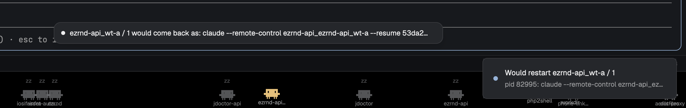

# Claude Resume

One key restarts the focused agent in place, on the same conversation. Press it once and a pill at the bottom of the main block asks you to press again; press it again within four seconds and the agent's program is ended, its terminal keeps its shell, and the same command line is typed back into it with `--resume <its session id>` added when it was missing. Nothing on screen moves: same pane, same tab, same address, so labels, pins and pets stay. Made for the moment Claude Code says "restart to apply the update" in a dozen panes.

## What you see

- Nothing, almost always. The mod is a floating block over the layout's main block (`edge: bottom`, `align: center`) that renders an empty `div()` while idle, so Herdr draws no frame and `herdr-app status` reports its bounds as 0 × 0.
- When it has something to say, one pill in Herdr's floating frame: 26px tall, 12px side padding, 12.5px `foreground` text truncated at 640px, with a 7px round dot on the left in the colour of what's happening:
  - **armed**: `blocked`, pulsing (opacity 0.3 to 1 every 700ms): `Restart <label> on the same session? Press the key again.`
  - **busy**: `working`, pulsing: `Stopping <label>…`, then `Starting <label> again…`
  - **ok**: `done`: `Restarted <label>`
  - **error**: `blocked`, still: the reason (`Nothing to restart: the terminal is at its shell prompt`, `<label> didn't stop (pid N)`, `<label>'s terminal is gone; start it again by hand`, `<label> still runs <program>`).
  - **dry run**: `foreground`: `<label> would come back as: <command line>`.
- `<label>` is the agent's `space_name / tab_name` from `agents()`, else the pane's title, else the address.
- A result pill clears itself after 4 s. A toast repeats success and failure (`Restarted <label>` with the command line; `Couldn't restart <label>` with the reason), and a dry run posts `Would restart <label>` with the old and new lines.

## How it behaves

- Agent statuses change nothing here. The mod only reacts to its commands; it never polls.
- Commands arrive through `nextCommand()`, from a key or `herdr-app do`. The text is `<name>` or `<name>:<terminal>`; without a terminal the target is `focused().terminal`. Three names:
  - `go`: the first call arms for that terminal (4 s, then forgotten); a second call for the **same** terminal while armed runs the restart. A call for another terminal re-arms for that one. Ignored while a restart is running.
  - `dry`: shows what `go` would type, changes nothing.
  - `cancel`: disarms.
- **Plan** (`hc get <terminal> --json`): the terminal's `foreground` is the program to restart, with its `argv` and `pid`. No foreground, or one whose `argv[0]` is a shell (`sh`, `bash`, `zsh`, `fish`, `nu`, `dash`, `ksh`, `pwsh`, `powershell`, `cmd`), is "Nothing to restart". The new line is the same `argv`, except:
  - `claude` with none of `-r`, `--resume`, `-c`, `--continue`, `--session-id` (also as `--flag=value`): `--resume <id>` is appended, `<id>` read from `~/.claude/sessions/<pid>.json` (`sessionId`) on the terminal's machine with `sh -c 'cat "$HOME/.claude/sessions/$1.json"'`. No file, no change.
  - a bare `codex` (one argument): `codex resume --last`.
  - Every argument is single-quoted unless it is only `[A-Za-z0-9_-./=:@%+,]`.
- **Restart**: `kill -TERM <pid>` on the terminal's machine (`on`: the part before `/` in a remote address, null here). Then every 300ms `kill -0 <pid>` until it is gone; after 8 s still alive, `kill -KILL`; after 15 s, give up with "didn't stop". Then 600ms for the shell to print its prompt, and `hc get` again: the terminal must still exist and its foreground must be gone or a shell. Then `hc send <terminal> <line>` (pastes and presses Enter). Any failed step ends with its message in the pill and a toast; nothing is retried.
- The terminal's own shell is what makes this work: Herdr starts agents in the person's interactive shell, which stays after the program exits, so the pane survives and the line lands at its prompt.

## Built from

- `mods/claude-resume/`: `mod.json` `{ "place": "none", "title": "Resume" }` and `main.js`. No layout, no other files.
- `main.js`: one `View`, `ClaudeResume`. `init` starts the `nextCommand()` loop; methods `go`, `dry`, `plan`, `restart`, `say`; `render` returns `div()` or the pill (`h_flex` from `gpui-base`, `.loop("opacity")` for the pulse). State: `armed {addr, label, n}`, `note {text, kind, n}`, `busy`, and a counter `n` so a late timer never clears a newer pill.
- From `herdr`: `focused`, `panes`, `agents`, `hc`, `exec`, `notify`, `nextCommand`, `theme`. Programs it runs: `hc get`, `hc send`, `kill`, `sleep`, `sh -c cat`. No files written, no network.
- Where it lives: a floating block in the person's layout, on the main block: `{ "id": "claude-resume-float", "content": { "mod": "claude-resume" }, "edge": "bottom", "align": "center" }`. Shipped layouts are read-only, so clone `main` first (`layout.clone`) and add it to the clone.
- `keys.json`: `"cmd-shift-r": "claude-resume.go"`, in `global` or in `layout:<the clone>` (the command only reaches a layout that shows the block anyway).

## Watch out

- `<mod>.<command>` reaches shown copies only. With `place: none` and no block in the layout, the key does nothing, silently. The floating block is the whole reason it works.
- `hc get` reports the **foreground** process, not what the terminal was started with (`argv` there is the shell, `["/bin/zsh","-l"]`). Its `cwd` can differ from the terminal's.
- `~/.claude/sessions/<pid>.json` is Claude Code's own registry of running sessions (2.1.x), keyed by pid. Don't fall back to `-c`: with three Claude sessions in one folder it continues the wrong one. A session already started with `--resume` keeps its line as is.
- Sending the line too early loses it: wait until the pid is gone **and** a moment more, then check `hc get` shows no foreground. SIGTERM is enough for Claude Code; the SIGKILL fallback is for programs that trap it.
- `hc send` refuses a `blocked` terminal without `--force`; after the program has exited the terminal has no status, so plain `send` is right. Don't add `--force`: it would type into a still-blocked agent if a step were skipped.
- The target is whatever `focused().terminal` says at the first press. If focus moves between the two presses, the second press arms the new one instead of restarting the old one.
- `herdr-app check` can't exercise the restart. Test `dry` first, then `go` on an idle agent you don't mind restarting.

## Done when

- `herdr-app check ~/.config/herdr-app/mods/claude-resume` passes and `herdr-app status` lists `claude-resume-float` with `0.0, 0.0` bounds while idle and no errors.
- `herdr-app do claude-resume.dry:<an agent's address>` shows the pill `… would come back as: …` with that agent's label, the float's bounds become non-zero, and a toast gives the old and new lines; the pill is gone 4 s later.
- `herdr-app do claude-resume.dry` with a plain shell focused shows `Nothing to restart: the terminal is at its shell prompt`.
- On an idle Claude Code agent started without `--resume`, the key twice: the pill goes armed, `Stopping…`, `Starting again…`, `Restarted <label>`; `hc get` shows a new foreground pid whose `argv` ends with `--resume <the session id that was in ~/.claude/sessions/<old pid>.json>`; the pane, tab and address are unchanged and the agent's screen shows the same conversation. (Checked on Herdr 0.1.12, macOS, Claude Code 2.1.318.)
- The key once, then nothing for 4 s: the pill disappears and nothing was restarted.
